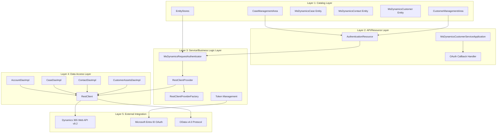
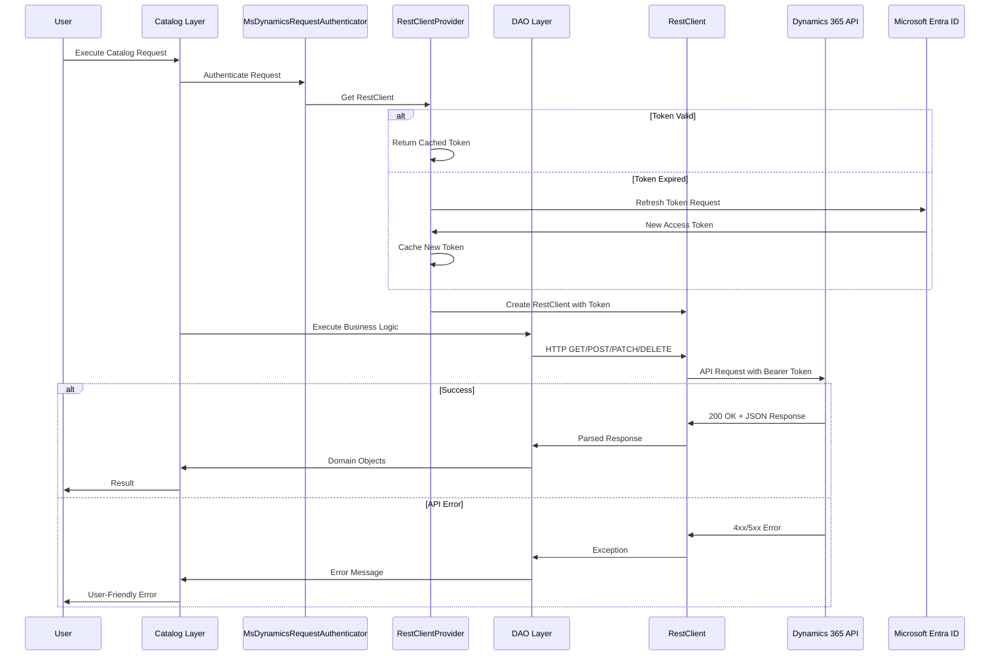
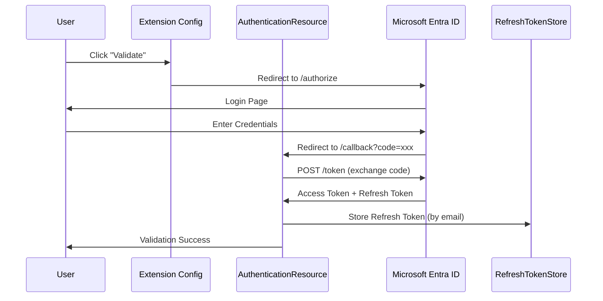
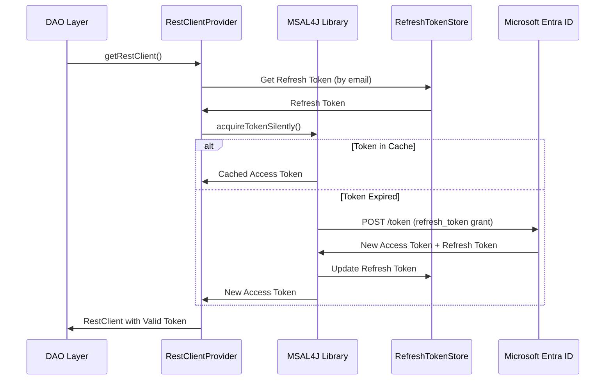
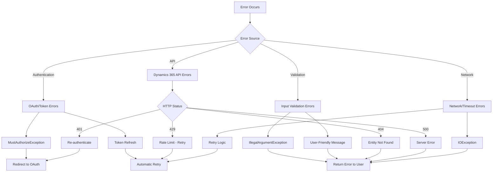
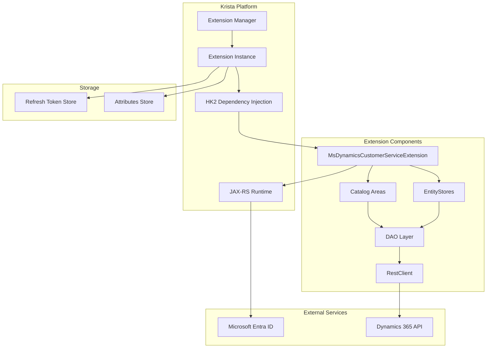
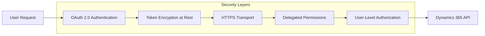

# Microsoft Dynamics 365 Customer Service Extension - Architecture Documentation

## Table of Contents
1. [Extension Overview](#extension-overview)
2. [Architecture Layers](#architecture-layers)
3. [Component Interaction](#component-interaction)
4. [Authentication Flow](#authentication-flow)
5. [Data Flow](#data-flow)
6. [Performance Analysis](#performance-analysis)
7. [Error Scenarios](#error-scenarios)
8. [Deployment Architecture](#deployment-architecture)

---

## Extension Overview

### Metadata
- **Extension Name**: Ms Dynamics 365 Customer Service
- **Version**: 2.0.6
- **JAX-RS ID**: dynamicscrm
- **Java Version**: Java 21
- **API Version**: Dynamics 365 Web API v9.2
- **Package**: `com.kristasoft.extensions.crm.customer_service.dynamics365_customer_service`

### Purpose
Provides seamless integration between Krista and Microsoft Dynamics 365 Customer Service, enabling CRUD operations on customer service entities (Cases, Contacts, Customers) and advanced querying capabilities for work orders, incidents, and customer assets.

### Key Capabilities
- OAuth 2.0 authentication via Microsoft Entra ID
- Service account and user account authentication modes
- EntityStore support for Cases, Contacts, and Customers
- 7 catalog requests across 2 functional areas
- Automatic token refresh and management
- OData v4.0 query support

---

## Architecture Layers

The extension follows a **5-layer architecture pattern** for separation of concerns and maintainability.



### Layer 1: Catalog Layer
**Purpose**: Defines the public interface for Krista users

**Components**:
- **CaseManagementArea**: 6 catalog requests
  - Get Subjects for Case
  - Pick Account Using Name
  - Get Contacts By Company Id
  - Get Lookup Account by Account Id
  - Get WorkOrder By AccountId
  - Get Incidents by Account ID
  
- **CustomerManagementArea**: 1 catalog request
  - Get Customer Assets by Account Id

- **Entity Definitions**:
  - `MsDynamicsCase`: Case/Incident entity with 8 fields
  - `MsDynamicsContact`: Contact entity with 14 fields
  - `MsDynamicsCustomer`: Customer/Account entity with 12 fields
  - `Account`, `WorkOrders`, `Incidents`, `CustomerAsset`: Supporting entities

- **EntityStores**:
  - `MsDynamicsCaseStore`: CRUD operations for cases
  - `MsDynamicsContactStore`: CRUD operations for contacts
  - `MsDynamicsCustomerStore`: CRUD operations for customers

**Responsibilities**:
- Define catalog request metadata (ID, type, parameters)
- Validate input parameters
- Map entity fields to Dynamics 365 API fields
- Provide searchable and displayable field annotations

### Layer 2: API/Resource Layer
**Purpose**: Handle HTTP endpoints and OAuth callbacks

**Components**:
- **AuthenticationResource** (`/callback`, `/authorize`)
  - Handles OAuth 2.0 authorization code callback
  - Exchanges authorization code for tokens
  - Stores refresh tokens securely
  - Implements `AuthorizationListener` interface

- **MsDynamicsCustomerServiceApplication**
  - JAX-RS application configuration
  - Registers REST resources
  - Defines application path: `/`

**Responsibilities**:
- Process OAuth 2.0 callbacks
- Handle authorization code exchange
- Manage HTTP request/response lifecycle
- Route requests to appropriate handlers

### Layer 3: Service/Business Logic Layer
**Purpose**: Implement authentication, authorization, and token management

**Components**:
- **MsDynamicsRequestAuthenticator**
  - Implements `RequestAuthenticator` interface
  - Determines authentication requirements
  - Extracts authenticated account ID from callbacks
  - Manages authorization context

- **RestClientProvider**
  - Provides authenticated `RestClient` instances
  - Manages access token lifecycle
  - Handles token refresh using MSAL4J
  - Supports both service account and user account modes
  - Throws `MustAuthorizeException` when authentication required

- **RestClientProviderFactory**
  - Factory pattern for creating `RestClientProvider` instances
  - Manages dependency injection
  - Stores extension attributes
  - Creates default and custom providers

- **Token Management**
  - `RefreshTokenStore`: Stores and retrieves refresh tokens
  - `MsDynamicsCustomerServiceAttributesStore`: Manages extension attributes
  - MSAL4J `ConfidentialClientApplication` for token operations

**Responsibilities**:
- Authenticate requests using OAuth 2.0
- Refresh expired access tokens automatically
- Manage token storage and retrieval
- Determine service vs. user authentication mode
- Handle authorization exceptions

### Layer 4: Data Access Layer (DAO)
**Purpose**: Encapsulate all Dynamics 365 API interactions

**Components**:
- **AccountDaoImpl**
  - `getAccountById(String id)`: Retrieve account by GUID
  - `getAllAccounts(...)`: Paginated account list
  - `getAccountByQuery(Map<String, Object>)`: Query-based retrieval
  - `createAccount(Map<String, Object>)`: Create new account
  - `updateAccount(Account)`: Update existing account
  - `deleteAccountById(String id)`: Delete account
  - `getLookupAccountByAccountId(String)`: Account with customer assets

- **CaseDaoImpl**
  - `getCaseById(String id)`: Retrieve case by GUID
  - `getCases(...)`: Paginated case list
  - `getCasesByQuery(Map<String, Object>)`: Query-based retrieval
  - `createCase(Map<String, Object>)`: Create new case
  - `updateCase(Case)`: Update existing case
  - `deleteCaseById(String id)`: Delete case
  - `getSubjects()`: Retrieve available subjects
  - `getWorkOrderByAccountId(...)`: Work orders with date filtering
  - `getIncidentsByAccountId(...)`: Incidents with timeline details

- **ContactDaoImpl**
  - `getContactById(String id)`: Retrieve contact by GUID
  - `getContacts(...)`: Paginated contact list
  - `getContactsByQuery(Map<String, Object>)`: Query-based retrieval
  - `createContact(Map<String, Object>)`: Create new contact
  - `updateContact(Contact)`: Update existing contact
  - `deleteAccountById(String id)`: Delete contact

- **CustomerAssetsDaoImpl**
  - Retrieves customer assets by account ID
  - Filters and maps asset data

- **RestClient**
  - `get(String url, Map<String, String> queryParams)`: HTTP GET
  - `post(String url, String body)`: HTTP POST
  - `patch(String url, String body)`: HTTP PATCH
  - `delete(String url)`: HTTP DELETE
  - Adds Bearer token to all requests
  - Handles response parsing and error handling

**Responsibilities**:
- Construct OData queries with $select, $filter, $orderby
- Map Java objects to/from JSON
- Handle OData bindings for relationships
- Implement pagination logic
- Transform API responses to domain objects
- Handle API-specific error codes

### Layer 5: External Integration Layer
**Purpose**: Communicate with external Microsoft services

**Components**:
- **Dynamics 365 Web API v9.2**
  - Base URL: `{Base URL}/api/data/v9.2/`
  - Endpoints: accounts, contacts, incidents, subjects, msdyn_customerassets, msdyn_workorders
  - Protocol: HTTPS with JSON payloads
  - Authentication: OAuth 2.0 Bearer tokens

- **Microsoft Entra ID OAuth 2.0**
  - Authority: `https://login.microsoftonline.com/{tenant-id}`
  - Grant Types: authorization_code, refresh_token
  - Scopes: `.default offline_access`
  - Token Endpoint: `/oauth2/v2.0/token`
  - Authorize Endpoint: `/oauth2/v2.0/authorize`

- **OData v4.0 Protocol**
  - Query options: $select, $filter, $orderby, $top, $skip, $expand
  - Filter functions: contains(), startswith(), endswith()
  - Logical operators: and, or, not
  - Comparison operators: eq, ne, gt, lt, ge, le

**Responsibilities**:
- Execute HTTP requests to Dynamics 365
- Handle OAuth 2.0 flows
- Parse OData responses
- Manage API rate limits and throttling
- Handle network errors and retries

---

## Component Interaction

### Request Processing Flow



### OAuth 2.0 Authentication Flow



### Token Refresh Flow



---

## Authentication Flow

### Service Account Authentication

**Configuration**:
- "Have people authenticate with their account" checkbox: **UNCHECKED**
- Uses administrator email configured during setup
- Single refresh token for all operations

**Flow**:
1. Administrator validates extension during configuration
2. OAuth flow completes, refresh token stored with admin email
3. All catalog requests use admin's refresh token
4. Access tokens refreshed automatically when expired
5. All operations performed under admin identity

**Use Cases**:
- Automated workflows
- Scheduled operations
- System-to-system integrations
- Background tasks

**Advantages**:
- No user interaction required
- Consistent permissions
- Simplified token management

**Disadvantages**:
- No user-level audit trail
- All operations use same permissions
- Cannot differentiate between users

### User Account Authentication

**Configuration**:
- "Have people authenticate with their account" checkbox: **CHECKED**
- Each user must authenticate separately
- Refresh tokens stored per user email

**Flow**:
1. User executes catalog request
2. Extension checks for user's refresh token
3. If not found, throws `MustAuthorizeException`
4. User redirected to OAuth flow
5. After authorization, refresh token stored with user's email
6. Subsequent requests use user's token
7. Operations performed under user's identity

**Use Cases**:
- User-specific permissions required
- Audit trail requirements
- Compliance scenarios
- Different permission levels per user

**Advantages**:
- User-level audit trail
- User-specific permissions enforced
- Compliance with access controls

**Disadvantages**:
- Each user must authenticate
- More complex token management
- Users need Dynamics 365 licenses

---

## Data Flow

### Create Entity Flow (Case Example)


**Key Steps**:
1. **Validation**: Check required fields (Case Title, Contact Id)
2. **Mapping**: Convert catalog entity to internal model
3. **OData Bindings**: Set relationships using `@odata.bind`
   - Contact: `customerid_contact@odata.bind=/contacts({guid})`
   - Subject: `subjectid@odata.bind=/subjects({guid})`
4. **Priority Mapping**: High=1, Normal=2, Low=3
5. **Status Mapping**: In Progress=1, On Hold=2, etc.
6. **API Call**: POST to `/api/data/v9.2/incidents`
7. **Response**: Parse JSON and map to entity

### Update Entity Flow (Contact Example)


**Key Steps**:
1. **Retrieve Existing**: GET current entity state
2. **Diff Calculation**: Only send changed fields
3. **Patch Payload**: JSON with only modified fields
4. **API Call**: PATCH to `/api/data/v9.2/contacts({guid})`
5. **Prefer Header**: `return=representation` to get updated entity
6. **Response**: Parse and return updated entity

### Query Flow (Search Example)


**OData Query Construction**:
- **$select**: `name,accountid,telephone1,address1_line1`
- **$filter**: `contains(name,'Contoso') and address1_city eq 'Seattle'`
- **$orderby**: `createdon desc`
- **$top**: `100` (pagination)
- **$skip**: `100` (offset)

---

## Performance Analysis

### API Rate Limits

**Microsoft Dynamics 365 Service Protection Limits**:

| Limit Type | Value | Impact |
|------------|-------|--------|
| API requests per user per 5 minutes | 6,000 | Throttling (429 error) |
| Concurrent requests per user | 52 | Requests queued |
| Execution time per request | 2 minutes | Timeout |
| Max page size (OData $top) | 5,000 | Pagination required |
| API requests per org per 24 hours | Varies by license | Shared quota |

**Extension Handling**:
- Automatic retry with exponential backoff on 429 errors
- Request queuing for concurrent limit
- Pagination for large result sets
- Timeout handling with user-friendly errors

### Performance Characteristics

| Operation | Typical Response Time | Factors Affecting Performance |
|-----------|----------------------|------------------------------|
| Get Subjects | 200-500ms | Small dataset, cached by Dynamics 365 |
| Search Accounts (by name) | 500ms-2s | Result set size, index usage |
| Get Contacts by Company | 500ms-2s | Number of contacts (1-100) |
| Create Case | 500ms-1s | Validation, workflow triggers |
| Update Contact | 500ms-1s | Field count, validation rules |
| Get Work Orders (filtered) | 1-5s | Date range, related data expansion |
| Get Incidents (with timeline) | 2-10s | Complex query, timeline details |
| Token Refresh | 200-500ms | Network latency to Entra ID |

### Optimization Strategies

**1. Field Selection**:
```
Good: $select=name,accountid,telephone1
Bad:  No $select (returns all 100+ fields)
```

**2. Pagination**:
```
Good: $top=100 with $skip for large sets
Bad:  Retrieving 10,000 records in one call
```

**3. Filtering Server-Side**:
```
Good: $filter=createdon gt 2024-01-01
Bad:  Retrieve all, filter in Java
```

**4. Caching**:
- Cache subjects list (rarely changes)
- Cache account lookups for session
- Don't cache frequently changing data (cases)

**5. Batch Requests**:
- Use OData $batch for multiple operations
- Reduces round trips
- Not currently implemented (future enhancement)

### Performance Limitations

1. **Network Latency**:
   - Extension → Dynamics 365: 50-200ms per request
   - Token refresh adds 200-500ms overhead

2. **API Complexity**:
   - Complex $expand queries can take 5-10 seconds
   - Timeline details require multiple API calls

3. **Data Volume**:
   - Large result sets require pagination
   - 5,000 record limit per page

4. **Concurrent Users**:
   - Shared API quota across organization
   - 52 concurrent requests per user limit

5. **Token Management**:
   - First request after token expiry adds refresh overhead
   - MSAL4J token cache reduces subsequent overhead

---

## Error Scenarios

### Error Handling Architecture



### Error Categories

#### 1. Authentication Errors

| Error | Cause | Handling | User Impact |
|-------|-------|----------|-------------|
| Invalid OAuth state parameter | Expired/tampered auth request | Restart OAuth flow | Must re-authenticate |
| Authentication token expired | Access token > 1 hour old | Automatic refresh | Transparent (auto-retry) |
| No valid authentication found | No refresh token stored | Throw `MustAuthorizeException` | Redirect to OAuth |
| Refresh token expired | 90 days of inactivity | Throw `MustAuthorizeException` | Must re-authenticate |
| Invalid client secret | Secret expired/incorrect | Configuration error | Admin must update config |

**Implementation**:
```java
// RestClientProvider.java
if (refreshToken == null) {
    throw new MustAuthorizeException("No valid authentication found");
}

try {
    IAuthenticationResult result = app.acquireTokenSilently(params).get();
    return new RestClient(baseUrl, result.accessToken());
} catch (Exception e) {
    throw new MustAuthorizeException("Authentication token has expired");
}
```

#### 2. Input Validation Errors

| Error | Cause | Validation | User Message |
|-------|-------|------------|--------------|
| Primary key cannot be empty | Null/empty ID parameter | `id == null \|\| id.isBlank()` | "Primary key cannot be empty. Please provide a valid ID." |
| Entity data is required | Null entity object | `entity == null` | "Entity data is required. Please provide valid entity information." |
| Invalid GUID format | Malformed GUID | Regex validation | "Invalid case ID format. Verify the case ID is a valid GUID." |
| Search conditions required | Empty search query | `conditions.isEmpty()` | "Search conditions are required. Please specify at least one search criterion." |
| Required field missing | Missing Case Title, Contact Id | Field validation | "Create operation failed. Verify all required fields are provided and valid." |

**Implementation**:
```java
// AccountDaoImpl.java
if (id == null || id.isBlank()) {
    throw new IllegalArgumentException(
        "Unable to fetch account. " + Constants.ID_IS_NULL_OR_EMPTY
    );
}
```

#### 3. API Operation Errors

| HTTP Status | Error | Cause | Handling |
|-------------|-------|-------|----------|
| 400 Bad Request | Invalid request payload | Malformed JSON, invalid field | Parse error, return user message |
| 401 Unauthorized | Invalid/expired token | Token issue | Refresh token, retry |
| 403 Forbidden | Insufficient permissions | User lacks permissions | Return permission error |
| 404 Not Found | Entity doesn't exist | Invalid ID | Return "Entity not found" |
| 429 Too Many Requests | Rate limit exceeded | Too many API calls | Retry with backoff |
| 500 Internal Server Error | Dynamics 365 error | Server-side issue | Return server error message |
| 503 Service Unavailable | Service down | Maintenance/outage | Retry later |

**Implementation**:
```java
// RestClient.java
private String handleResponse(Response response) {
    if (response.getStatus() == 401) {
        // Token expired - will be refreshed on retry
        throw new RuntimeException("Unauthorized - token expired");
    }
    if (response.getStatus() == 404) {
        throw new RuntimeException("Entity not found");
    }
    if (response.getStatus() == 429) {
        // Rate limit - implement retry
        throw new RuntimeException("Rate limit exceeded");
    }
    if (response.getStatus() >= 400) {
        throw new RuntimeException("API error: " + response.getStatus());
    }
    return response.readEntity(String.class);
}
```

#### 4. Network and Timeout Errors

| Error | Cause | Handling | Recovery |
|-------|-------|----------|----------|
| Connection timeout | Network connectivity issue | Retry with backoff | Inform user, suggest retry |
| Read timeout | Slow API response | Increase timeout, retry | Inform user of delay |
| SSL/TLS error | Certificate issue | Log error, fail request | Check certificate config |
| DNS resolution failure | Invalid Base URL | Fail immediately | Verify Base URL config |
| Connection refused | Firewall/network block | Fail immediately | Check network/firewall |

### Error Recovery Strategies

**1. Automatic Token Refresh**:
```java
// Transparent to user - no action required
try {
    return restClient.get(url, params);
} catch (UnauthorizedException e) {
    // Token expired - refresh and retry
    restClient = provider.getRestClient(); // Gets new token
    return restClient.get(url, params);
}
```

**2. Retry with Exponential Backoff**:
```java
// For rate limiting (429) and transient errors
int maxRetries = 3;
int retryDelay = 1000; // 1 second

for (int i = 0; i < maxRetries; i++) {
    try {
        return restClient.get(url, params);
    } catch (RateLimitException e) {
        if (i == maxRetries - 1) throw e;
        Thread.sleep(retryDelay * Math.pow(2, i));
    }
}
```

**3. User Re-authentication**:
```java
// When refresh token expired
try {
    return provider.getRestClient();
} catch (Exception e) {
    throw new MustAuthorizeException(
        "Authentication token has expired. Initiating re-authentication flow."
    );
}
```

### Error Message Design Principles

1. **Clarity**: Describe what went wrong in plain language
2. **Actionability**: Tell user what to do next
3. **Context**: Include relevant details (e.g., "Verify the case ID is a valid GUID")
4. **No Jargon**: Avoid technical terms when possible
5. **Consistency**: Use standard format across all errors

**Example Improvements**:
- ❌ Bad: "Failed to get customer"
- ✅ Good: "Unable to retrieve customer record. Verify the customer ID exists and you have read permissions."

---

## Deployment Architecture

### Extension Deployment Model



### Deployment Configuration

**Extension Attributes** (Stored in Krista):
- Client ID (GUID)
- Client Secret (Secured, encrypted)
- Tenant ID (GUID, secured)
- Base URL (HTTPS URL)
- Email (Administrator email)

**Runtime Dependencies**:
- Java 21 Runtime
- JAX-RS 2.1 (Jersey implementation)
- MSAL4J (Microsoft Authentication Library)
- Gson (JSON parsing)
- ScribeJava (OAuth 2.0 client)
- HK2 (Dependency injection)

**Network Requirements**:
- Outbound HTTPS to `login.microsoftonline.com` (port 443)
- Outbound HTTPS to Dynamics 365 instance (port 443)
- Inbound HTTPS for OAuth callback (configured redirect URI)

### Security Architecture



**Security Features**:

1. **OAuth 2.0 Authentication**:
   - Industry-standard authentication
   - No password storage
   - Short-lived access tokens (1 hour)
   - Refresh tokens for long-term access

2. **Token Security**:
   - Refresh tokens encrypted at rest
   - Access tokens in memory only
   - Tokens associated with email (isolation)
   - Automatic token rotation

3. **Transport Security**:
   - All communication over HTTPS
   - TLS 1.2+ required
   - Certificate validation

4. **Permission Model**:
   - Delegated permissions (user context)
   - No application permissions (no elevated access)
   - User-specific permissions enforced by Dynamics 365
   - Admin consent required for API access

5. **Attribute Security**:
   - Client Secret marked as secured (encrypted)
   - Tenant ID marked as secured (encrypted)
   - No credentials in logs or error messages

### Scalability Considerations

**Horizontal Scaling**:
- Extension is stateless (tokens stored externally)
- Multiple Krista instances can use same extension
- Token store must be shared across instances

**Vertical Scaling**:
- Memory: ~50MB per extension instance
- CPU: Minimal (I/O bound, not CPU bound)
- Network: Primary bottleneck

**Concurrency**:
- Thread-safe DAO implementations
- RestClient instances per request
- Token refresh synchronized per user

**Caching Strategy**:
- MSAL4J caches access tokens in memory
- No application-level caching (data freshness priority)
- Consider caching subjects list (rarely changes)

### Monitoring and Observability

**Logging**:
- SLF4J logging framework
- Log levels: ERROR, WARN, INFO, DEBUG
- Key log points:
  - Authentication events
  - Token refresh operations
  - API errors (with sanitized details)
  - Performance metrics

**Metrics to Monitor**:
- API request count and latency
- Token refresh frequency
- Error rate by category
- Rate limit hits (429 errors)
- Authentication failures

**Health Checks**:
- `testConnection()`: Calls Dynamics 365 WhoAmI endpoint
- `validateConnection()`: Verifies configuration and connectivity
- OAuth callback availability

### Disaster Recovery

**Token Loss Scenarios**:
- **Refresh Token Lost**: User must re-authenticate
- **Access Token Lost**: Automatically refreshed from refresh token
- **All Tokens Lost**: All users must re-authenticate

**Configuration Backup**:
- Extension attributes stored in Krista database
- Client Secret should be backed up securely
- Document Tenant ID and Client ID

**API Outage**:
- Dynamics 365 API down: Requests fail, retry later
- Microsoft Entra ID down: Cannot refresh tokens, use cached access tokens
- Network outage: Requests fail immediately

---

## Best Practices

### Development Best Practices

1. **Always Validate Input**:
   - Check for null/empty values
   - Validate GUID format
   - Verify required fields present

2. **Use OData Efficiently**:
   - Always use $select to limit fields
   - Filter server-side with $filter
   - Paginate large result sets

3. **Handle Errors Gracefully**:
   - Provide user-friendly error messages
   - Log technical details for debugging
   - Implement retry logic for transient errors

4. **Respect API Limits**:
   - Monitor rate limit headers
   - Implement backoff on 429 errors
   - Batch operations when possible

5. **Secure Credentials**:
   - Never log tokens or secrets
   - Use secured attributes for sensitive data
   - Rotate client secrets regularly

### Operational Best Practices

1. **Monitor Token Expiration**:
   - Refresh tokens expire after 90 days of inactivity
   - Set up alerts for approaching expiration
   - Proactively re-authenticate service accounts

2. **Review Permissions Regularly**:
   - Audit API permissions in Microsoft Entra ID
   - Remove unused permissions
   - Follow principle of least privilege

3. **Test Connection Regularly**:
   - Use Test Connection button after configuration changes
   - Verify connectivity after network changes
   - Test both service and user authentication modes

4. **Plan for API Changes**:
   - Monitor Dynamics 365 API version deprecations
   - Test extension with new API versions
   - Have rollback plan for breaking changes

5. **Document Custom Configurations**:
   - Document any custom entity mappings
   - Record API permission requirements
   - Maintain runbook for common issues

---

## Appendix

### API Endpoints Reference

| Entity | Endpoint | Primary Key Field |
|--------|----------|-------------------|
| Accounts | `/api/data/v9.2/accounts` | accountid |
| Contacts | `/api/data/v9.2/contacts` | contactid |
| Incidents (Cases) | `/api/data/v9.2/incidents` | incidentid |
| Subjects | `/api/data/v9.2/subjects` | subjectid |
| Customer Assets | `/api/data/v9.2/msdyn_customerassets` | msdyn_customerassetid |
| Work Orders | `/api/data/v9.2/msdyn_workorders` | msdyn_workorderid |

### OData Field Mappings

**Case/Incident Fields**:
- `title` → Case Title
- `ticketnumber` → Case Number
- `incidentid` → Case Id
- `_customerid_value` → Contact Id
- `_subjectid_value` → Subject Id
- `prioritycode` → Priority (1=High, 2=Normal, 3=Low)
- `statuscode` → Case Status
- `description` → Description

**Contact Fields**:
- `contactid` → Id
- `firstname` → First Name
- `lastname` → Last Name
- `_parentcustomerid_value` → Account Id
- `mobilephone` → Mobile Phone
- `emailaddress1` → Email
- `address1_line1` → Street 1

**Account Fields**:
- `accountid` → Customer Id
- `name` → Customer Name
- `telephone1` → Phone
- `websiteurl` → Website
- `_primarycontactid_value` → Primary Contact Id
- `_parentaccountid_value` → Parent Customer Id

### Constants Reference

```java
// API Endpoints
AUTHORITY = "https://login.microsoftonline.com/"
API_ENDPOINT = "/api/data/v9.2/"
ACCOUNTS_API = "accounts"
INCIDENTS_API = "incidents"
CONTACTS_API = "contacts"

// OAuth
REQUIRED_SCOPE = ".default offline_access"

// OData
SELECT = "$select"
FILTER = "$filter"
ORDER_BY = "$orderby"
```

### Version History

| Version | Date | Changes |
|---------|------|---------|
| 2.0.6 | 2024 | Current version - Error message improvements |
| 2.0.x | 2024 | Java 21 upgrade, MSAL4J integration |
| 1.x | 2023 | Initial release with OAuth 2.0 |

---

## Conclusion

The Microsoft Dynamics 365 Customer Service Extension provides a robust, secure, and performant integration between Krista and Dynamics 365. The 5-layer architecture ensures separation of concerns, maintainability, and extensibility. Comprehensive error handling, automatic token management, and adherence to API best practices make this extension production-ready for enterprise deployments.

For additional information, refer to:
- [Extension Configuration Guide](../src/main/resources/docs/pages/ExtensionConfiguration.md)
- [Authentication Documentation](../src/main/resources/docs/pages/Authentication.md)
- [Error Handling Guide](../main/resources/docs/pages/ErrorHandling.md)
- [Complete DOCX Documentation](Dynamics365_Customer_Service_Complete_Documentation.docx)

---

**Document Version**: 1.0
**Last Updated**: November 2024
**Extension Version**: 2.0.6

