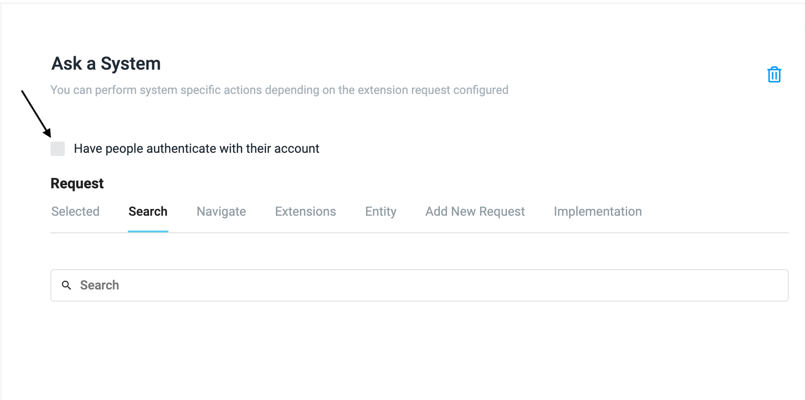
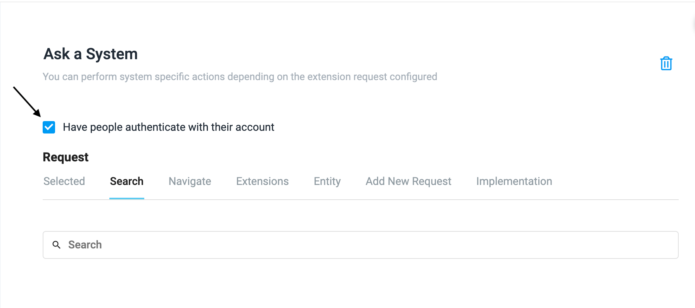

# Authentication

## Overview

The Microsoft Dynamics 365 Customer Service Extension uses OAuth 2.0 authentication through Microsoft Entra ID (formerly Azure AD) to securely access your Dynamics 365 Customer Service instance. The extension supports two authentication modes to accommodate different use cases:

1. **Service Account Authentication** - Uses a single service account for all operations
2. **User Account Authentication** - Each user authenticates with their own Dynamics 365 account

This document provides comprehensive information about authentication modes, OAuth 2.0 flows, token management, and security best practices.

## Authentication Modes

### Service Account Authentication

Service account authentication uses the credentials configured during extension setup for all operations, regardless of which user initiates the request.

**When to Use**:
- Automated workflows and scheduled operations
- System-to-system integrations
- Batch processing operations
- When consistent permissions are required across all users
- Background tasks that don't require user context

**How to Enable**:
- Leave the "Have people authenticate with their account" checkbox **unchecked** in the catalog request configuration



**Characteristics**:
- Single authentication during setup
- No user interaction required during execution
- Consistent permissions across all operations
- Simplified token management
- All operations performed under service account identity
- Cannot differentiate between individual users in audit logs

**Token Management**:
- Uses the refresh token associated with the administrator email configured during setup
- Access tokens are automatically refreshed when expired
- No user interaction required for token refresh

### User Account Authentication

User account authentication requires each user to authenticate with their own Dynamics 365 account before executing operations.

**When to Use**:
- Operations that require user-specific permissions
- Audit trail requirements for individual user actions
- Compliance scenarios requiring user attribution
- When different users have different permission levels
- Interactive operations initiated by end users

**How to Enable**:
- Check the "Have people authenticate with their account" checkbox in the catalog request configuration



**Characteristics**:
- Operations performed under individual user identity
- User-specific permissions enforced
- Clear audit trail for each user
- Compliance with user-level access controls
- Each user must authenticate separately
- Users must have appropriate Dynamics 365 licenses and permissions

**Token Management**:
- Each user gets their own access and refresh tokens
- Tokens are stored per user
- Users must re-authenticate if their tokens expire

## OAuth 2.0 Scopes and Permissions

The extension requires specific OAuth 2.0 scopes to access Dynamics 365 Customer Service APIs.

### Required Scopes

| Scope | Full URL | Permission Level | Purpose |
|-------|----------|------------------|---------|
| Dynamics CRM Default | `{Base URL}/.default` | Delegated | Access to all Dynamics 365 APIs the user has permissions for |
| Offline Access | `offline_access` | Delegated | Obtain refresh tokens for long-term access |

### Scope Details

#### 1. Dynamics CRM Default Scope

- **Full URL**: `https://yourorg.crm.dynamics.com/.default`
- **Type**: Delegated permission
- **What it allows**:
  - Read and write access to Dynamics 365 Customer Service data
  - Access to all entities (accounts, contacts, cases, etc.)
  - Execute operations on behalf of the authenticated user
  - Subject to user's permissions in Dynamics 365

- **Why this scope**:
  - The `.default` scope requests all permissions that have been pre-configured for the app registration
  - Simplifies permission management by using Microsoft Entra ID app registration permissions
  - Automatically includes all delegated permissions granted to the app

- **Alternative**: Individual API permissions (e.g., `user_impersonation`)
  - **Why not used**: The `.default` scope is more flexible and includes all configured permissions
  - **When to use alternatives**: When you need fine-grained control over specific permissions

#### 2. Offline Access Scope

- **Full URL**: `offline_access`
- **Type**: Standard OAuth 2.0 scope
- **What it allows**:
  - Obtain refresh tokens during authentication
  - Maintain long-term access without user interaction
  - Automatically refresh access tokens when they expire

- **Why this scope**:
  - Essential for service account authentication
  - Enables automated workflows without user intervention
  - Prevents frequent re-authentication requirements

- **Token Lifetime**:
  - Refresh tokens are valid for 90 days of inactivity
  - Tokens are automatically renewed when used
  - After 90 days of inactivity, re-authentication is required

### Permission Configuration in Microsoft Entra ID

The following permissions must be configured in your Microsoft Entra ID app registration:

1. **Dynamics CRM API**:
   - Permission: `user_impersonation`
   - Type: Delegated
   - Admin Consent: Required

2. **Microsoft Graph API**:
   - Permission: `offline_access`
   - Type: Delegated
   - Admin Consent: Not required (standard OAuth scope)

> **Note**: Admin consent must be granted for the Dynamics CRM `user_impersonation` permission. This is typically done during the app registration setup.

## OAuth 2.0 Grant Types

The extension uses two OAuth 2.0 grant types for authentication and token management.

### Authorization Code Grant

The authorization code grant is used for initial authentication when a user (or administrator) first authorizes the extension.

- **Grant Type**: `authorization_code`
- **Used For**: Initial authentication and obtaining the first set of tokens
- **User Interaction**: Required
- **Flow**: User is redirected to Microsoft login page, grants consent, and is redirected back with an authorization code

**Request Example**:
```http
GET https://login.microsoftonline.com/{tenant-id}/oauth2/v2.0/authorize?
  client_id={client-id}
  &response_type=code
  &redirect_uri=https://krista.example.com/ext/abc123/dynamicscrm/callback
  &response_mode=query
  &scope=https://yourorg.crm.dynamics.com/.default offline_access
  &state={random-state-value}
```

**Response Example**:
```http
HTTP/1.1 302 Found
Location: https://krista.example.com/ext/abc123/dynamicscrm/callback?
  code={authorization-code}
  &state={random-state-value}
```

**Token Exchange Request**:
```http
POST https://login.microsoftonline.com/{tenant-id}/oauth2/v2.0/token
Content-Type: application/x-www-form-urlencoded

grant_type=authorization_code
&client_id={client-id}
&client_secret={client-secret}
&code={authorization-code}
&redirect_uri=https://krista.example.com/ext/abc123/dynamicscrm/callback
&scope=https://yourorg.crm.dynamics.com/.default offline_access
```

**Token Response**:
```json
{
  "token_type": "Bearer",
  "scope": "https://yourorg.crm.dynamics.com/.default offline_access",
  "expires_in": 3600,
  "access_token": "eyJ0eXAiOiJKV1QiLCJhbGc...",
  "refresh_token": "0.AXoA1234567890abcdef..."
}
```

### Refresh Token Grant

The refresh token grant is used to obtain new access tokens when the current access token expires, without requiring user interaction.

- **Grant Type**: `refresh_token`
- **Used For**: Automatic token refresh when access tokens expire
- **User Interaction**: Not required
- **Flow**: Extension automatically exchanges refresh token for new access token

**Request Example**:
```http
POST https://login.microsoftonline.com/{tenant-id}/oauth2/v2.0/token
Content-Type: application/x-www-form-urlencoded

grant_type=refresh_token
&client_id={client-id}
&client_secret={client-secret}
&refresh_token={refresh-token}
&scope=https://yourorg.crm.dynamics.com/.default offline_access
```

**Response Example**:
```json
{
  "token_type": "Bearer",
  "scope": "https://yourorg.crm.dynamics.com/.default offline_access",
  "expires_in": 3600,
  "access_token": "eyJ0eXAiOiJKV1QiLCJhbGc...",
  "refresh_token": "0.AXoA1234567890abcdef..."
}
```

> **Note**: The refresh token may be rotated (a new refresh token is returned). The extension automatically handles this and stores the new refresh token.

## Authentication Flow

### Initial Authentication Flow

1. **User Clicks "Validate"**: In the extension configuration page
2. **Redirect to Microsoft Entra ID**: Extension redirects to Microsoft login page
3. **User Authentication**: User enters credentials and grants consent
4. **Authorization Code**: Microsoft Entra ID redirects back with authorization code
5. **Token Exchange**: Extension exchanges code for access and refresh tokens
6. **Token Storage**: Tokens are encrypted and stored securely
7. **Validation Success**: User is notified of successful authentication

### Token Refresh Flow

1. **API Call**: Extension makes API call to Dynamics 365
2. **Token Expired**: Dynamics 365 returns 401 Unauthorized
3. **Automatic Refresh**: Extension exchanges refresh token for new access token
4. **Retry Request**: Extension retries original API call with new token
5. **Success**: Operation completes successfully

## Token Management

### Access Token

- **Lifetime**: 1 hour (3600 seconds)
- **Format**: JWT (JSON Web Token)
- **Storage**: In-memory during request processing
- **Refresh**: Automatically refreshed when expired using refresh token
- **Scope**: Limited to the requested scopes (Dynamics CRM and offline access)

### Refresh Token

- **Lifetime**: 90 days of inactivity
- **Format**: Opaque string
- **Storage**: Encrypted in Krista's secure storage, associated with email address
- **Renewal**: Automatically renewed when used (rolling refresh)
- **Revocation**: Can be revoked by user, administrator, or security events

## Token Expiration Scenarios

### Scenario 1: Access Token Expiration (Normal)

**When**: After 1 hour of token issuance

**Handling**: Extension automatically refreshes token using refresh token

**User Impact**: None - completely transparent

**Resolution**: Automatic - no action required

### Scenario 2: Refresh Token Expiration (90 Days Inactivity)

**When**: Extension unused for more than 90 days

**Handling**: Refresh token is invalid, re-authentication required

**User Impact**: Must re-authenticate through OAuth flow

**Resolution**: Click "Validate" button and complete OAuth authorization

### Scenario 3: Token Revocation

**When**: User revokes app permissions or security event occurs

**Handling**: All tokens invalidated, API calls fail

**User Impact**: All operations fail until re-authentication

**Resolution**: Re-validate extension and re-grant permissions

## Security Best Practices

### 1. Token Security

- Never log or display access tokens or refresh tokens
- Tokens are automatically encrypted at rest
- Tokens are transmitted only over HTTPS
- Tokens are stored per user/email to prevent cross-user access

### 2. Service Account Security

- Use a dedicated service account email
- Enable multi-factor authentication (MFA) on service account
- Regularly review service account permissions
- Monitor service account activity in Microsoft Entra ID logs
- Rotate client secrets every 6-12 months

### 3. User Account Security

- Enforce MFA for all users
- Use conditional access policies in Microsoft Entra ID
- Regularly review user permissions in Dynamics 365
- Monitor for unusual authentication patterns

### 4. Permission Management

- Only grant minimum required permissions
- Use delegated permissions instead of application permissions
- Regularly audit granted permissions
- Remove unused permissions

## Troubleshooting Authentication

### Issue: "Authentication Failed"

**Cause**: Invalid credentials or expired tokens

**Solution**:
1. Verify Client ID, Client Secret, and Tenant ID are correct
2. Check if client secret has expired in Microsoft Entra ID
3. Re-validate the extension
4. Ensure admin consent is granted

### Issue: "Insufficient Permissions"

**Cause**: Required API permissions not granted or admin consent missing

**Solution**:
1. Go to Microsoft Entra ID → App registrations → Your app → API permissions
2. Verify Dynamics CRM `user_impersonation` permission is present
3. Click "Grant admin consent for {organization}"
4. Wait a few minutes for permissions to propagate

### Issue: "Token Expired - Re-authentication Required"

**Cause**: Refresh token expired after 90 days of inactivity

**Solution**:
1. Click "Validate" button in extension configuration
2. Complete OAuth authorization flow
3. New refresh token will be obtained

## See Also

- [Extension Configuration](pages/ExtensionConfiguration.md) - Complete configuration guide
- [Creating Dynamics 365 App](pages/CreatingDynamics365App.md) - Microsoft Entra ID app registration
- [Release Notes](pages/release-notes.md) - Version history and updates

