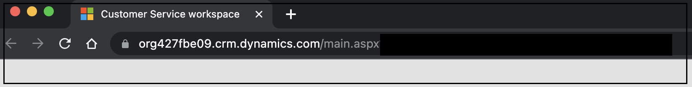
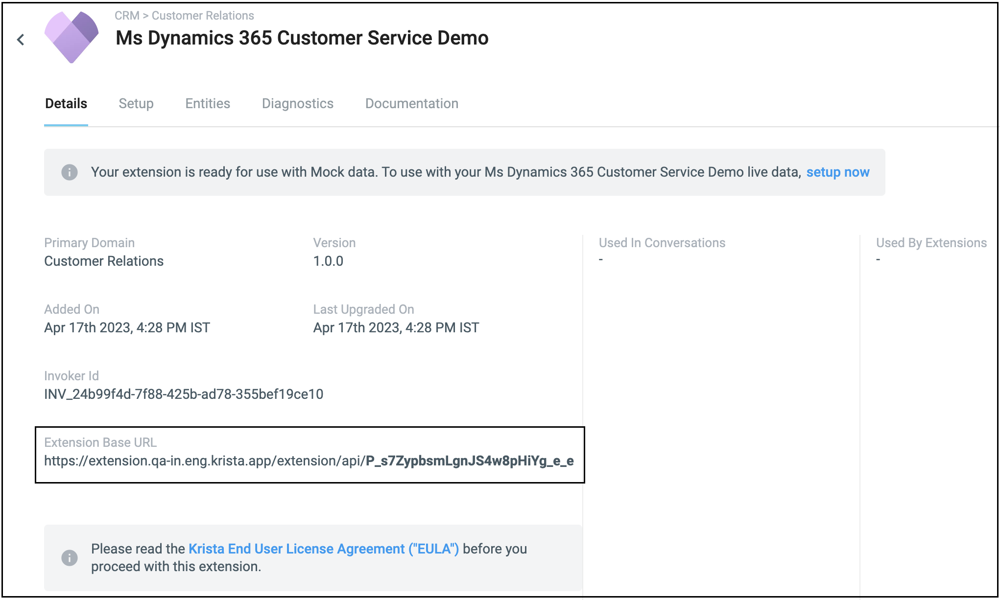
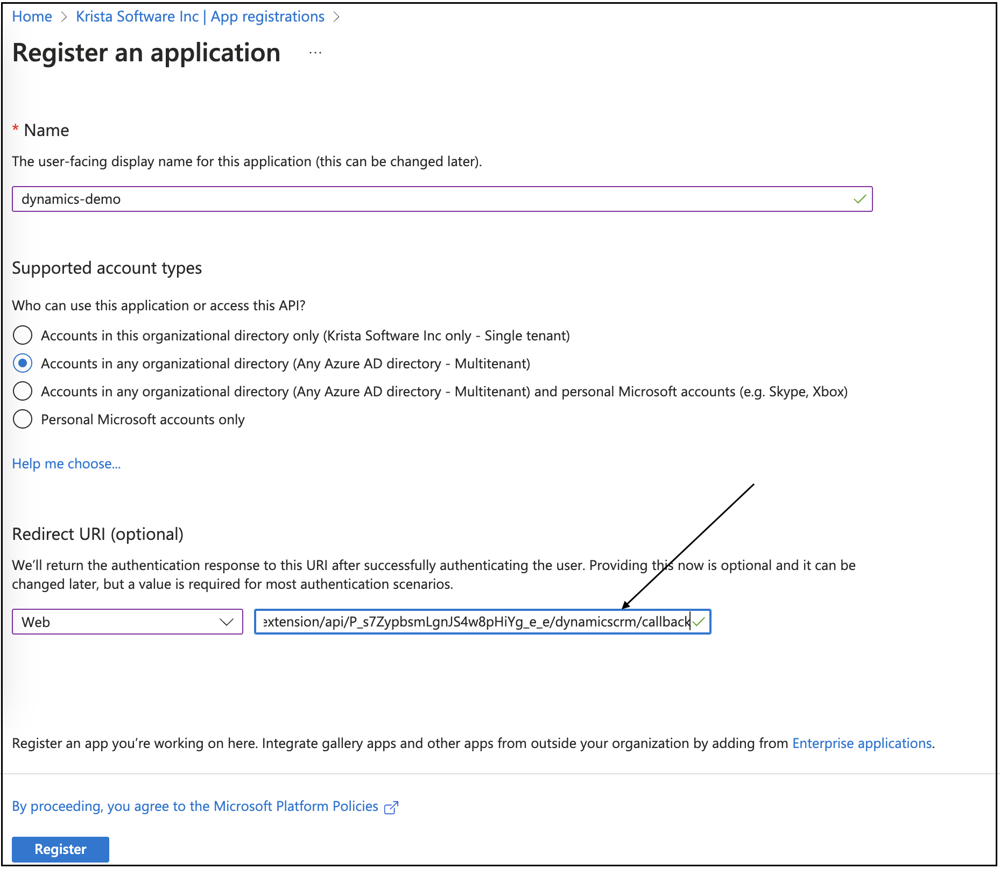
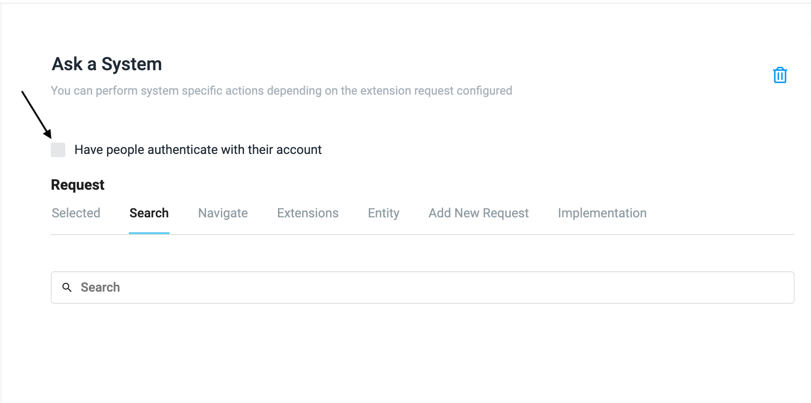
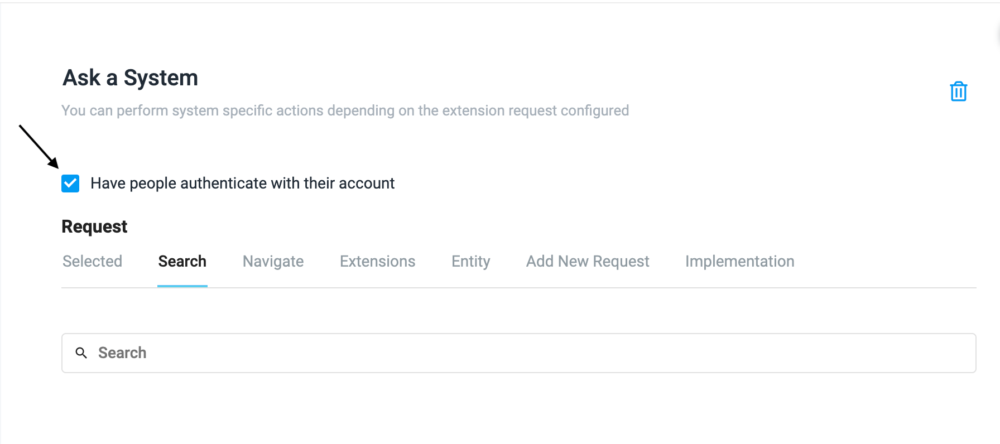

# Extension Configuration

## Overview

The Microsoft Dynamics 365 Customer Service Extension requires proper configuration to establish a secure connection with your Dynamics 365 instance. This configuration uses OAuth 2.0 authentication through Microsoft Entra ID (formerly Microsoft Entra ID) to ensure secure access to your customer service data.

This guide walks you through all configuration parameters, setup steps, and best practices for configuring the extension.

## Configuration Parameters

The following parameters are required to configure the extension:

| Parameter | Type | Required | Description | Example |
|-----------|------|----------|-------------|---------|
| Client ID | Text | Yes | OAuth 2.0 client identifier from Microsoft Entra ID app registration | `12345678-1234-1234-1234-123456789abc` |
| Client Secret | Text (Secured) | Yes | OAuth 2.0 client secret from Microsoft Entra ID app registration | `abc123~DEF456.ghi789-JKL012` |
| Tenant ID | Text (Secured) | Yes | Microsoft Entra ID tenant identifier for your organization | `87654321-4321-4321-4321-cba987654321` |
| Base URL | Text | Yes | Your Dynamics 365 Customer Service instance URL | `https://myorg.crm.dynamics.com` |
| Email | Text | Yes | Administrator email address for service account authentication | `admin@myorg.com` |

### Parameter Details

#### Client ID
- **Purpose**: Identifies your Microsoft Entra ID application
- **Format**: GUID (Globally Unique Identifier)
- **Location**: Azure Portal → App Registrations → Your App → Overview → Application (client) ID
- **Security**: Not sensitive, but should be kept private
- **Validation**: Must be a valid GUID format

#### Client Secret
- **Purpose**: Authenticates your application to Microsoft Entra ID
- **Format**: Alphanumeric string with special characters
- **Location**: Azure Portal → App Registrations → Your App → Certificates & secrets
- **Security**:  **Highly sensitive** - treat like a password
- **Expiration**: Client secrets expire based on your configuration (typically 6 months to 2 years)
- **Validation**: Must match the secret created in Microsoft Entra ID

#### Tenant ID
- **Purpose**: Identifies your Microsoft Entra ID organization
- **Format**: GUID (Globally Unique Identifier)
- **Location**: Azure Portal → App Registrations → Your App → Overview → Directory (tenant) ID
- **Security**: Moderately sensitive
- **Validation**: Must be a valid GUID format

#### Base URL
- **Purpose**: The root URL of your Dynamics 365 Customer Service instance
- **Format**: HTTPS URL without trailing slash
- **Example**: `https://myorganization.crm.dynamics.com`
- **How to Find**: 
  1. Log in to your Dynamics 365 Customer Service instance
  2. Copy the URL from the address bar
  3. Extract everything before the first forward slash after the domain
  4. Example: If URL is `https://myorg.crm.dynamics.com/main.aspx`, use `https://myorg.crm.dynamics.com`
- **Validation**: Must be a valid HTTPS URL

#### Email
- **Purpose**: Administrator email for service account authentication and token management
- **Format**: Valid email address
- **Usage**: Used to store and retrieve refresh tokens for the service account
- **Validation**: Must be a valid email format
- **Note**: This should be the same email used during the initial OAuth authorization

## Step-by-Step Setup

### Step 1: Create Microsoft Entra ID App Registration

Before configuring the extension, you must create an Microsoft Entra ID app registration. Follow the detailed guide in [Creating Dynamics 365 App](pages/CreatingDynamics365App.md).

### Step 2: Gather Required Credentials

1. **Obtain Client ID and Tenant ID**:
   - Navigate to Azure Portal → Microsoft Entra ID → App registrations
   - Select your application
   - In the Overview page, copy the **Application (client) ID** and **Directory (tenant) ID**

   

2. **Obtain Client Secret**:
   - In your app registration, go to **Certificates & secrets**
   - Copy the **Value** of your client secret (not the Secret ID)
   -  **Important**: The secret value is only shown once when created. If you didn't save it, create a new one.

   

3. **Obtain Base URL**:
   - Log in to your Dynamics 365 Customer Service instance
   - Copy the base URL from the address bar (everything before the first `/`)

   

### Step 3: Configure Redirect URI

The redirect URI (callback URL) must be configured in both Microsoft Entra ID and the Krista extension.

1. **Get Extension Base URL**:
   - In Krista, navigate to the extension's **Details** tab
   - Copy the **Extension Base URL** (also called Routing URL)

   

2. **Construct Callback URL**:
   - Append `/dynamicscrm/callback` to the Extension Base URL
   - Example: If Extension Base URL is `https://krista.example.com/ext/abc123`, the callback URL is:
     ```
     https://krista.example.com/ext/abc123/dynamicscrm/callback
     ```

3. **Add Redirect URI to Microsoft Entra ID**:
   - In Azure Portal, go to your app registration
   - Navigate to **Authentication** → **Platform configurations** → **Web**
   - Add the callback URL as a Redirect URI
   - Click **Save**

   

### Step 4: Enter Configuration in Krista

1. Navigate to the extension configuration page in Krista
2. Enter all required parameters:
   - **Client ID**: Paste the Application (client) ID from Microsoft Entra ID
   - **Client Secret**: Paste the client secret value
   - **Tenant ID**: Paste the Directory (tenant) ID
   - **Base URL**: Enter your Dynamics 365 instance URL
   - **Email**: Enter the administrator email address

### Step 5: Validate Configuration

1. Click the **Validate** button in the extension configuration
2. You will be redirected to Microsoft's OAuth authorization page
3. Sign in with the **same administrator account** used to create the Microsoft Entra ID app registration
4. Grant the requested permissions
5. You will be redirected back to Krista

> **Note**: The validation process exchanges the authorization code for access and refresh tokens, which are securely stored for future use.

### Step 6: Test Connection

1. After successful validation, click the **Test Connection** button
2. The extension will call the Dynamics 365 `WhoAmI` endpoint to verify connectivity
3. If successful, you'll see a confirmation message
4. If it fails, review the [Troubleshooting](#troubleshooting) section below

## Authentication Type Selection

The extension supports two authentication modes:

### Service Account Authentication (Default)

- **When to Use**: For automated workflows, scheduled operations, and system-to-system integrations
- **How to Enable**: Leave the "Have people authenticate with their account" checkbox **unchecked**
- **Behavior**: All operations use the service account credentials configured during setup
- **Token**: Uses the refresh token associated with the administrator email



### User Account Authentication

- **When to Use**: When operations should be performed in the context of individual users
- **How to Enable**: Check the "Have people authenticate with their account" checkbox
- **Behavior**: Each user must authenticate with their own Dynamics 365 account
- **Token**: Each user gets their own access and refresh tokens
- **Permissions**: Operations are subject to each user's permissions in Dynamics 365



## Security Considerations

### Best Practices

1. **Protect Client Secret**:
   - Never commit client secrets to version control
   - Rotate client secrets regularly (every 6-12 months)
   - Use Azure Key Vault for additional security in production

2. **Limit Permissions**:
   - Only grant the minimum required API permissions
   - Use delegated permissions instead of application permissions when possible
   - Regularly review and audit permissions

3. **Monitor Access**:
   - Enable Microsoft Entra ID sign-in logs
   - Monitor for unusual authentication patterns
   - Set up alerts for failed authentication attempts

4. **Email Security**:
   - Use a dedicated service account email
   - Enable multi-factor authentication (MFA) on the service account
   - Regularly review token usage

5. **Base URL Validation**:
   - Always use HTTPS
   - Verify the URL matches your organization's Dynamics 365 instance
   - Avoid using development/test instances in production configurations

### Token Security

- Access tokens are short-lived (typically 1 hour)
- Refresh tokens are stored securely and encrypted
- Tokens are automatically refreshed when expired
- Tokens are associated with the email address for service account mode

## Troubleshooting

### Issue: "Invalid Client Secret"

**Cause**: The client secret has expired or is incorrect

**Solution**:
1. Go to Azure Portal → App registrations → Your app → Certificates & secrets
2. Create a new client secret
3. Update the extension configuration with the new secret
4. Re-validate the connection

### Issue: "Redirect URI Mismatch"

**Cause**: The redirect URI in Microsoft Entra ID doesn't match the callback URL

**Solution**:
1. Verify the Extension Base URL in Krista
2. Ensure the callback URL is exactly: `{Extension Base URL}/dynamicscrm/callback`
3. Add this exact URL to Microsoft Entra ID redirect URIs
4. Remove any trailing slashes
5. Ensure the protocol is HTTPS

### Issue: "Insufficient Permissions"

**Cause**: Required API permissions are not granted or admin consent is missing

**Solution**:
1. Go to Azure Portal → App registrations → Your app → API permissions
2. Verify the following permissions are present:
   - **Dynamics CRM**: `user_impersonation`
   - **Microsoft Graph**: `offline_access`
3. Click "Grant admin consent" for your organization
4. Wait a few minutes for permissions to propagate
5. Re-validate the connection

### Issue: "Malformed URL"

**Cause**: The Base URL is incorrect or contains invalid characters

**Solution**:
1. Verify the Base URL format: `https://yourorg.crm.dynamics.com`
2. Remove any trailing slashes
3. Ensure it's the base URL, not a full page URL
4. Verify the URL is accessible from your network

### Issue: "Connection Test Failed"

**Cause**: Network connectivity issues or invalid credentials

**Solution**:
1. Verify all configuration parameters are correct
2. Check network connectivity to Dynamics 365
3. Ensure the service account has access to Dynamics 365
4. Review Microsoft Entra ID sign-in logs for authentication errors
5. Try re-validating the connection

### Issue: "Token Expired - Re-authentication Required"

**Cause**: The extension has been inactive for more than 90 days

**Solution**:
1. Click the **Validate** button again
2. Re-authenticate with the administrator account
3. The refresh token will be renewed

## Next Steps

After successfully configuring the extension:

1. **Review Authentication**: Learn about authentication modes in [Authentication](pages/Authentication.md)
2. **Explore Catalog Requests**: Start using the available operations
3. **Test Operations**: Try simple queries like [Get Subjects for Case](pages/GetSubjectsForCase.md)

## See Also

- [Authentication](pages/Authentication.md) - Detailed authentication documentation
- [Creating Dynamics 365 App](pages/CreatingDynamics365App.md) - Microsoft Entra ID app registration guide
- [Release Notes](pages/release-notes.md) - Version history and updates

